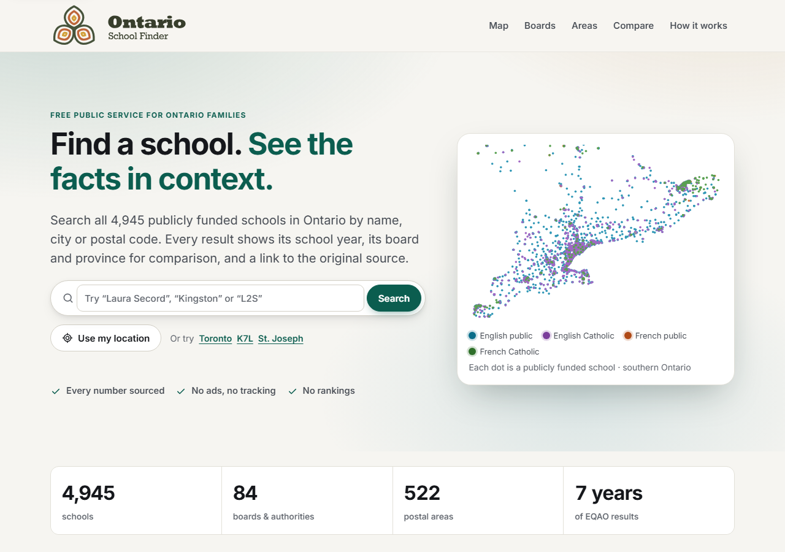

# Ontario School Finder

A free, fast, ad-free website where parents can find Ontario's publicly funded schools by name, city, postal code or street address, and see each school's public results **in context** — next to its board and the province, over several years — with a link to every original source.

- No accounts, ads, tracking cookies or analytics. The only third-party requests are map tiles (OpenFreeMap) and, only when you search an address, the Government of Canada's geolocation service.
- No rankings and no single score. Withheld or missing values are labelled, never shown as 0.
- Every page is pre-generated static HTML, so it is fast, cheap to host, shareable, and the core facts work without JavaScript.

**Live at [ontarioschoolfinder.ca](https://ontarioschoolfinder.ca).** Not affiliated with EQAO, the Ministry of Education or any school board.



What's on it:

- **A page for every school** (4,945): EQAO results since 2016-17 next to the board and Ontario medians, enrolment since 2011-12, students by grade, class sizes, French and SHSM programs, student context, child care and EarlyON nearby, the nearest schools, and its attendance area (the board's official boundary where one is published, otherwise a clearly labelled estimate).
- **Board pages** (84) with official board results, spending per student and other context, and **postal-area pages** (522) with census figures and every school inside.
- **Compare** up to six schools on every measure, with a share link, CSV download and print layout.
- **A province-wide map** with filters and labelled area layers, and **search** by name, city, postal code, street address or your location (never stored or sent).
- **How it works** (`/methodology/`) lists every source with its licence, retrieval date and how each number is built.

## How it fits together

```
pipeline/   Python: download the public datasets, validate every column, clean, join, build map layers
            -> site/data/*.json + site/data/geo/*.geojson + pipeline/report.md
site/       Python page generator (Jinja templates) + vanilla JS/CSS + self-hosted MapLibre GL
            -> site/dist/ (one page per school, board and postal area)
tests/e2e/  Playwright tests and evidence screenshots
deploy/     nginx config (strict CSP, caching, gzip) for the Docker image
check.sh    the definition of done: clean rebuild + every test + screenshots
```

### Data sources

| # | Source | Used for | Licence |
|---|--------|----------|---------|
| 1 | Ontario *School information and student demographics* (9 files: 2015-16, 2017-18 to 2024-25) | school list, coordinates, EQAO results 2016-17 to 2024-25, student context | OGL – Ontario |
| 2 | Ontario *public school contact information* (Nov 2026) | phone, email, website, open status, opening date | OGL – Ontario |
| 3 | EQAO *Open Data* achievement results (2025-26) | school results for the year the Ministry's school file doesn't have yet | OGL – Ontario (used under licence) |
| 4 | Ontario *School board achievements and progress* (May + Nov 2026 releases) | official board results, credits, graduation | OGL – Ontario |
| 5 | Ontario *public schools enrolment* (2011-12 to 2024-25) | enrolment trend | OGL – Ontario |
| 7 | Statistics Canada 2021 FSA boundary file | postal-area outlines | Statistics Canada Open Licence |
| 9 | Statistics Canada 2021 Census Profile by FSA (Census Profile API) | area context | Statistics Canada Open Licence |
| 10 | Ontario *Licensed child care facilities* (Sept 2026) | child care at each school's address and in each area | OGL – Ontario |
| 11 | Attendance boundaries from 7 boards' own public map layers (Waterloo Region DSB, Hamilton-Wentworth DSB, Simcoe County DSB, Grand Erie DSB, Dufferin-Peel CDSB, Kawartha Pine Ridge DSB, Halton CDSB) | official attendance area on school pages and the Map | **No licence stated**: shown while we ask each board for permission, removed on request ([docs/attendance-boundaries.md](docs/attendance-boundaries.md)) |
| 12 | Ontario *School enrolment by grade* (2017-18 to 2024-25) | students in each grade | OGL – Ontario |
| 13 | Ontario *Elementary class size* (2007-08 to 2025-26) | class sizes per school, 19 years | OGL – Ontario |
| 14 | Ontario *Public schools offering French as a Second Language programs* (2024-25) | Core, Extended French and Immersion per school | OGL – Ontario |
| 15 | Ontario *Specialist High Skills Major program list* (2025-26) | SHSM sectors per high school | OGL – Ontario |
| 16 | Ontario *Suspension and expulsion rates by school board* (to 2021-22) | board context | OGL – Ontario |
| 17 | Ontario *School board financial reports* (2024-25 financial statements) | spending per student by board | Licence not specified (owner chose to use it) |
| 18 | Ontario *French as a Second Language enrolment* (2024-25) | FSL enrolment by board | OGL – Ontario |
| 19 | Ontario *EarlyON Child and Family Centre locations* (Nov 2026) | EarlyON programs by postal area | OGL – Ontario |
| 20 | Ontario *Student Nutrition Program sites* (Dec 2017) | breakfast, lunch or snack program at the school | OGL – Ontario |

Skipped: #6 *Board service area* (listed as "under review" with no files) and #8 census subdivisions (only needed for #6). Details and retrieval dates are on `/methodology/` and in `pipeline/report.md`.

## Branding

Field Guide is the selected trillium logo. All three retro designs, editable SVG masters, previews and complete web assets are preserved in [branding/](branding/README.md). Use `npm run brand -- --brand field-guide` (or `civic-trillium` / `common-bloom`) to select and regenerate the artwork, then rebuild the site before publishing.

## Run it

Requirements: Python 3.11+ (tested on 3.14), Node 18+ (only for Playwright tests), Git Bash on Windows.

```bash
python -m venv .venv
.venv/Scripts/pip install -r requirements.txt     # .venv/bin/pip on macOS/Linux
npm install                                        # Playwright (uses an installed Chromium)
./check.sh                                         # full clean rebuild + tests + screenshots (~10 min)
```

Quicker loops:

```bash
.venv/Scripts/python -m pipeline.build        # reuse downloaded files in pipeline/cache
.venv/Scripts/python site/generate.py         # rebuild pages only
SKIP_PIPELINE=1 ./check.sh                    # tests + screenshots on the current data
SLOW=1 npx playwright test tests/e2e/links.slow.spec.js   # check external source links
```

Generator settings (environment variables): `SITE_URL`, `CONTACT_EMAIL`, `CORRECTIONS_URL`, `OPERATOR`.
The public contact address is never committed: set `CONTACT_EMAIL` in your own environment (once, e.g. as a Windows user variable)
so every rebuild includes it. To rebuild pages and deploy in one step: `bash scripts/publish.sh`.

## Deploy

The site is a folder of static files. It is served by nginx in a small Docker image on CapRover:

```bash
./check.sh                      # or build without tests
./deploy.sh ontario-schools     # packs site/dist into one archive, builds the nginx image on CapRover
```

Live at **https://ontarioschoolfinder.ca** (CapRover app `ontario-schools`, also reachable at ontario-schools.behind7proxies.com). DNS is on Cloudflare: apex and `www` are A records to the CapRover server, **DNS only** (not proxied) so CapRover can issue Let's Encrypt certificates. To (re)attach the domain, enable HTTPS, redirect `www` and the behind7proxies address to the apex, rebuild canonical URLs and deploy:

```bash
scripts/connect-domain.sh            # defaults: ontarioschoolfinder.ca ontario-schools
```

It also works on any static host (GitHub Pages, Cloudflare Pages) by publishing `site/dist`; copy the headers from `deploy/security-headers.conf`.

## Updating the data

Run the pipeline again. It re-downloads every source, checks every column it reads, and **stops with an expected-vs-found message if a file changes** instead of guessing. New yearly files are added in `pipeline/sources.py` (one line each).

See [docs/DECISIONS.md](docs/DECISIONS.md) for where this build departs from the original brief ([docs/idea.md](docs/idea.md)) and why,
and [docs/HANDOFF.md](docs/HANDOFF.md) for open items and lessons learned (read it before changing the pipeline or deploying).

## Corrections, issues and security

- Spotted a wrong number or a school in the wrong place? Use the **Report a correction** link on any school page, or open a
  [data correction issue](../../issues/new/choose). See [CONTRIBUTING.md](CONTRIBUTING.md).
- Found a security problem? Please report it privately: see [SECURITY.md](SECURITY.md).

## Copyright and reuse

© 2026 Ryan Morris. All rights reserved. The code is public so anyone can see how every number is built, but it is
**not** released under an open-source licence: please ask before copying or reusing it.

The data belongs to its publishers and keeps their licences (listed in the table above and on `/methodology/`): mostly the
Open Government Licence – Ontario and the Statistics Canada Open Licence. The generated data files (`site/data/`) and the
downloaded sources (`pipeline/cache/`) are not stored in this repository; the pipeline fetches them from the original
publishers. School boards' attendance boundaries are shown on the site with each board's credit and are not redistributed here.
